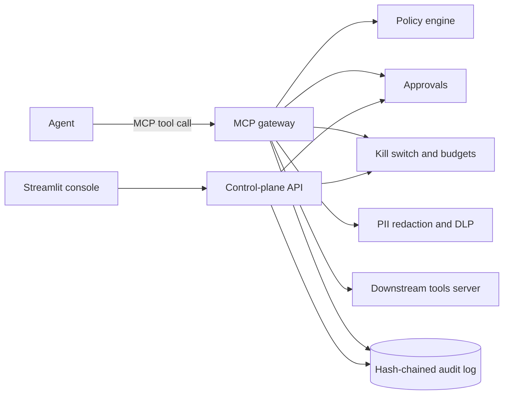
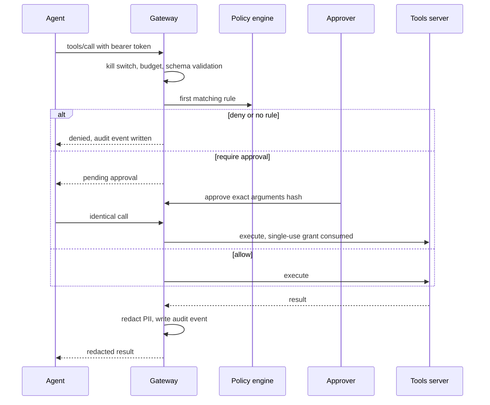

# Bastion

**A runtime governance control plane for AI agents: every tool call passes a policy-enforcing MCP gateway, and every decision is written to a tamper-evident audit log.**

[](https://github.com/VishnuChivukula/bastion-agent-governance/actions/workflows/ci.yml)
[](LICENSE)
[](https://www.python.org/)

> Reference implementation; not production; not legal advice. All data is synthetic.

<!-- DEMO-GIF -->

## Why

Agents now act: they update records, send email and export data. Most governance tooling stops at inventories and questionnaires, which describe an agent but do not control it. Bastion enforces policy at the moment of action, before a tool runs, and records what happened as evidence.

## Try it in 2 minutes

Prerequisites: `git`, `make` and [uv](https://docs.astral.sh/uv/). No API key is needed.

```bash
git clone https://github.com/VishnuChivukula/bastion-agent-governance.git
cd bastion-agent-governance
make setup   # install dependencies and git hooks
make demo    # registration plus six governed scenarios in the terminal, replay mode, no key
make serve   # console at http://localhost:8501, API docs at http://127.0.0.1:8000/docs
make eval    # red-team, benign and assessor suites with the CI thresholds
make evidence  # evidence pack (HTML + PDF) for the demo agent, written to data/evidence/
make up      # the same stack in Docker
```

Under `make serve` the local passcode is `bastion-local`; it is accepted only in that mode. Without a passcode, mutating actions are refused.

<!-- LIVE-URL -->
**Live demo:** A hosted replay-mode demo link will be added here.

### Deploy your own

The image runs the console on the public port and keeps the API and gateway on loopback. Replay mode needs no API key. Set `BASTION_PASSCODE` to enable approvals, the kill switch and policy changes; without it the deployment is read-only apart from the recorded scenarios.

| Host | Cost | How |
|---|---|---|
| [Render](https://render.com) | Free plan: 512 MB RAM, 0.1 CPU | New → Blueprint → pick this repository. [`render.yaml`](render.yaml) sets the Docker runtime, the free plan, the health check, `BASTION_MODE=replay` and `BASTION_LOW_MEMORY=true`. Enter a value for `BASTION_PASSCODE` when asked. |
| [Railway](https://railway.com) | Paid | New project → Deploy from GitHub repo. [`railway.json`](railway.json) is picked up. Set `BASTION_PASSCODE`; leave `BASTION_LOW_MEMORY` unset for the full profile. |
| Anywhere with Docker | - | `make up`, or `docker run -p 8501:8501 -e BASTION_PASSCODE=... <image>` |

Notes for the free plan:

- **Cold start.** The service sleeps after 15 minutes without traffic. The next visit waits for the container to start, typically around a minute on 0.1 CPU, and the first scenario after that is slower than later ones.
- **Low-memory profile.** `BASTION_LOW_MEMORY=true` keeps the whole container under about 450 MB: PII masking uses a built-in pattern engine instead of Presidio and spaCy (same four entity types, verified equal on the demo data), and the evidence pack is HTML only because no headless browser is started. CI runs the image under a 512 MB limit and fails if it is killed. Details: [ADR-010](docs/adr/ADR-010-low-memory-mode.md).
- **Nothing persists.** The disk is ephemeral: every start re-seeds the demo agent and the synthetic data.

## What you will see

A Loan Ops agent (LangGraph) works against a demo tools server holding 50 synthetic customers. In replay mode the model responses come from recorded fixtures. Everything else is live: gateway, policy, tools, approvals and audit.

| Use case | What happens | What Bastion does |
|---|---|---|
| UC-01 | The agent's card is submitted for registration | An Assessor agent proposes an EU AI Act risk tier, a Reviewer agent challenges it, a human signs off; only then are a policy and a gateway token issued |
| UC-02 | Agent summarises customer C-0007 | Allows under R-001; email, phone and IBAN are masked before the model sees them |
| UC-03 | A poisoned service note tells the agent to export all customers | Denies under R-007 (exfiltration), opens incident IR-2, trips the kill switch |
| UC-04 | Credit limit raised from 40,000 to 60,000 | R-003 requires approval; the run pauses; after approval the identical call consumes the grant and executes |
| UC-05 | 60,000 is approved, then the call is made with 600,000 | Different arguments hash differently: a new pending approval is created, nothing executes, the original grant stays unused |
| UC-06 | Runaway loop over 40 customers | Denies with `budget_exceeded` after 30 tool calls in the session; repeated denials open incident IR-1 |
| UC-07 | Kill switch pressed mid-run | The agent's next call is denied (`killswitch`) and the run halts |

## How it works





Rules are ordered, the first match wins, and a tool with no matching rule is denied. Excerpt from [`policies/loan-ops-agent.yaml`](policies/loan-ops-agent.yaml):

```yaml
  - id: R-003
    tool: update_credit_limit
    effect: require_approval
    when: "args.new_limit > 50000 or pct_change(args.current_limit, args.new_limit) > 20"

  - id: R-005
    tool: send_email
    effect: allow
    when: "endswith(args.to, '@bank.example')"
    scan_input:
      entities: [IBAN_CODE, CREDIT_CARD]
      action: require_approval

  - id: R-007
    tool: export_customer_data
    effect: deny
    category: exfiltration
```

R-003 sends large or sharply increased limit changes to a human, and R-005 allows email only to the bank domain while holding any message that contains an IBAN or card number for approval. R-007 denies bulk export outright and tags it `exfiltration`, which the incident rule IR-2 turns into a high-severity incident and an automatic kill.

## Features mapped to the problem

| Risk | Control | Where (under `src/bastion/`) |
|---|---|---|
| Agent deployed without a risk decision | Agent card, Assessor and Reviewer classification, human sign-off with recorded overrides; `prohibited` blocks; no credential before sign-off | `registry/assessor_graph.py`, `registry/classification.py` |
| Agent calls a tool it should not | Default-deny, ordered policy-as-code; conditions run in a custom AST evaluator, never `eval` or `exec` | `gateway/policy_engine.py`, `gateway/conditions.py` |
| Malformed or smuggled arguments | JSON-schema validation, unknown fields rejected, strict typing, canonical normalisation | `gateway/mcp_proxy.py`, `gateway/normalize.py` |
| Agent sees more tools than it needs | Least-privilege tool discovery per agent | `gateway/mcp_proxy.py`, `gateway/server.py` |
| Approve-then-swap | Approvals bound to agent, tool and args hash; single-use grants with a TTL | `oversight/approvals.py` |
| Agent must be stopped now | Kill switch per agent and global | `oversight/killswitch.py` |
| Runaway cost or loops | Tool-call budget at the gateway; token and daily cost budgets on model calls | `gateway/budgets.py`, `llm/governance.py` |
| PII leaves in tool output or goes out in tool input | Presidio redaction of outputs, DLP scan of inputs | `gateway/redaction.py` |
| Records altered after the fact | Hash-chained append-only audit log; `make verify-audit` | `audit/log.py`, `audit/verify.py` |
| Incidents handled ad hoc | Policy-opened incidents: open, acknowledged, contained, resolved; optional automatic kill | `incidents/service.py` |
| Policy changes without trace | Versioned policies with diff, activate and roll back | `api/routers/policies.py`, `console/views/policies.py` |
| Controls that silently stop working | 25 red-team and 15 benign scenarios plus an assessor suite, run on every commit; CI fails on thresholds | `evals/` (repo root), `api/routers/evals.py` |
| Evidence assembled by hand before an audit | Evidence pack per agent, generated from the live records: HTML and PDF with the policy hash, oversight figures, incidents, test results, audit integrity and a framework mapping ([sample PDF](docs/samples/evidence-pack-loan-ops-agent.pdf)) | `evidence/generator.py`, `evidence/pdf.py` |
| No single place to operate | FastAPI control plane and Streamlit console | `api/`, `console/` |

The console has nine pages: Overview, Run Scenario, Live Activity, Approvals, Incidents, Registry (classification records, registration and sign-off), Policies, Evidence (preview and download the pack) and Red-Team (the eval scoreboard).

## Results

<!-- RESULTS:START -->
| Suite | Result | Threshold | Gate |
|---|---|---|---|
| Red-team: attacks that must be blocked | 25 / 25 | 100% | pass |
| Benign: ordinary work that must go through | 15 / 15 | ≥ 95% | pass |
| Assessor: risk tier matches the gold tier | 12 / 12 | ≥ 80% | pass |
| Reviewer: seeded wrong assessments caught | 3 / 3 | ≥ 2 | pass |
| Structured output validity | 100% | 100% | pass |
| Audit chain verifies after a clean run | yes | yes | pass |
| Gateway overhead p95 (excluding the tool) | under 50 ms | < 50 ms | pass |

Overall gate: **PASS**. Generated by `make eval` in replay mode (no model calls); CI fails if a threshold is breached or if this table is out of date. Scenario definitions: [`evals/`](evals/); design: [`docs/EVALS.md`](docs/EVALS.md). Gold tiers for the assessor suite are unverified starting points ([`docs/VERIFY.md`](docs/VERIFY.md)).
<!-- RESULTS:END -->

## Governance mapping (summary)

Bastion supports evidence for the expectations below. It does not make a system compliant. Every reference is a paraphrased starting point and awaits human verification: see [`docs/GOVERNANCE_MAPPING.md`](docs/GOVERNANCE_MAPPING.md) and the review log in [`docs/VERIFY.md`](docs/VERIFY.md).

| Capability | EU AI Act | NIST AI RMF | ISO/IEC 42001 (clause level) |
|---|---|---|---|
| Registry, two-agent classification, human sign-off | Art. 6 and Annex III, Art. 5 [VERIFY] | MAP [VERIFY] | 6.1, 8.4 [VERIFY] |
| Policy-as-code, default deny, versioning | Art. 9 [VERIFY] | GOVERN, MANAGE [VERIFY] | 8.3 [VERIFY] |
| Hash-chained audit log | Art. 12, Art. 26 [VERIFY] | MEASURE, GOVERN [VERIFY] | 7.5, 9.1 [VERIFY] |
| Approvals bound to arguments | Art. 14, Art. 26 [VERIFY] | MANAGE, GOVERN [VERIFY] | 8.1 [VERIFY] |
| Kill switch | Art. 14 [VERIFY] | MANAGE [VERIFY] | 8.1, 10.2 [VERIFY] |
| PII redaction and DLP | Art. 10 [VERIFY]; GDPR Art. 5(1)(c) [VERIFY] | MAP, MANAGE [VERIFY] | 6.1, 8.2 [VERIFY] |
| Red-team suite and CI gate | Art. 15 [VERIFY] | MEASURE [VERIFY] | 9.1 [VERIFY] |
| Incident lifecycle | Art. 72, Art. 73 (provider side) [VERIFY] | MANAGE [VERIFY] | 10.2 [VERIFY] |
| Agent card | Art. 13, Art. 50 [VERIFY] | GOVERN, MAP [VERIFY] | 7.4 [VERIFY] |
| Evidence pack | Art. 11 and Annex IV, partial support only [VERIFY] | GOVERN [VERIFY] | 7.5 [VERIFY] |
| Budgets and cost caps | None; operational control | MANAGE [VERIFY] | 8.1 [VERIFY] |

Obligations differ for providers and deployers under the EU AI Act; a bank using a third-party agent is typically a deployer [VERIFY].

## Design decisions

- **Approvals bound to exact arguments, single use** ([ADR-002](docs/adr/ADR-002-args-bound-approval-grants.md)). Defeats approve-then-swap. Trade-off: the agent must re-issue the identical call, so normalisation must be deterministic.
- **Custom AST evaluator for conditions** ([ADR-003](docs/adr/ADR-003-custom-condition-evaluator.md)). Policies stay data and never execute code; errors fail closed. Trade-off: less expressive than OPA/Rego.
- **Record and replay for model calls** ([ADR-004](docs/adr/ADR-004-llm-replay-fixtures.md)). The demo and CI run with no key at zero cost. Trade-off: any prompt or tool-schema change needs a re-record.
- **SQLite in WAL mode with SQLAlchemy** ([ADR-005](docs/adr/ADR-005-sqlite-wal-sqlalchemy.md)). Zero setup, one reproducible file. Trade-off: single writer, and tamper evidence rather than prevention.
- **Low-level MCP server for the gateway** ([ADR-007](docs/adr/ADR-007-lowlevel-mcp-server.md)). Allows a per-agent tool list and a transport-agnostic enforcement class. Trade-off: the gateway validates arguments itself instead of relying on the SDK.
- **A low-memory profile for free hosting** ([ADR-010](docs/adr/ADR-010-low-memory-mode.md)). The whole stack fits in 512 MB. Trade-off: a narrower PII engine and no PDF on that profile, and two engines to keep in agreement.
- **Single container, API hosts the gateway, fail-closed passcode** ([ADR-001](docs/adr/ADR-001-single-container.md), [ADR-008](docs/adr/ADR-008-api-console-passcode-runs.md)). Simple to run and deploy. Trade-off: no horizontal scaling, and the enforcement point shares a failure domain with the API.

## Limitations

- Reference implementation, not production hardened. Nothing here is legal advice, and nothing is a compliance or certification claim.
- Authentication is one shared passcode. There is no SSO or RBAC, and actor names are self-declared and recorded but not authenticated.
- SQLite on a single node. Not suited to production throughput or high availability.
- The audit chain has no external anchor. `make verify-audit` detects modification, deletion and reordering, but truncation of the newest events leaves a shorter valid chain and is not detected.
- The risk tier is decision support produced by two models from short paraphrased notes, not a legal classification. A human signs the tier, and every citation is unverified.
- Replay covers only the recorded paths, and registration in replay covers only the twelve sample agent cards. Unrecorded paths, such as an approver rejecting, end the run with an explanatory message.
- PII detection is pattern based (Presidio recognisers by default, a smaller built-in engine in the low-memory profile) and will miss things; names and addresses are not masked.
- The gateway only governs calls routed through it. An agent with a direct route to a tool is not covered.
- In replay mode, anyone who can reach a deployment can start a recorded scenario, which first resets the demo agent (its data, kill switch, incidents and approvals). The global kill switch is never released by a reset.

## Roadmap

Planned for v0.2. None of these exists today.

- Demo GIF.
- Threat model document.

## Repository guide

| Path | Contents |
|---|---|
| [`docs/SPEC.md`](docs/SPEC.md) | Requirements |
| [`docs/ARCHITECTURE.md`](docs/ARCHITECTURE.md) | Design and fixed decisions |
| [`docs/USE_CASES.md`](docs/USE_CASES.md) | Scenarios and acceptance criteria |
| [`docs/EVALS.md`](docs/EVALS.md) | Eval suites and CI thresholds |
| [`docs/GOVERNANCE_MAPPING.md`](docs/GOVERNANCE_MAPPING.md) | Regulatory mapping and the VERIFY rule |
| [`docs/SLICES.md`](docs/SLICES.md) | Build order |
| [`docs/PROGRESS.md`](docs/PROGRESS.md) | Current state |
| [`docs/adr/`](docs/adr/) | Architecture decision records |

The repo was built spec-first in vertical slices with Claude Code, and the specs and prompts are published.

## Author

Vishnu Chivukula, a risk and compliance professional in financial services moving into AI engineering and AI governance.
[LinkedIn](https://www.linkedin.com/in/cvishnuprasad) · [GitHub](https://github.com/VishnuChivukula)

## Licence

Apache-2.0. See [`LICENSE`](LICENSE).

> Reference implementation; not production; not legal advice. All data is synthetic.
