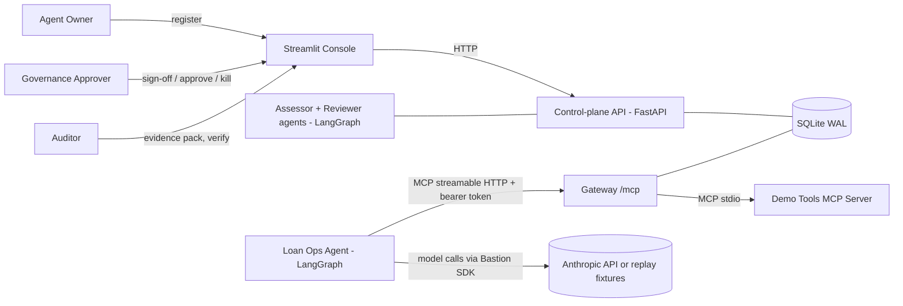
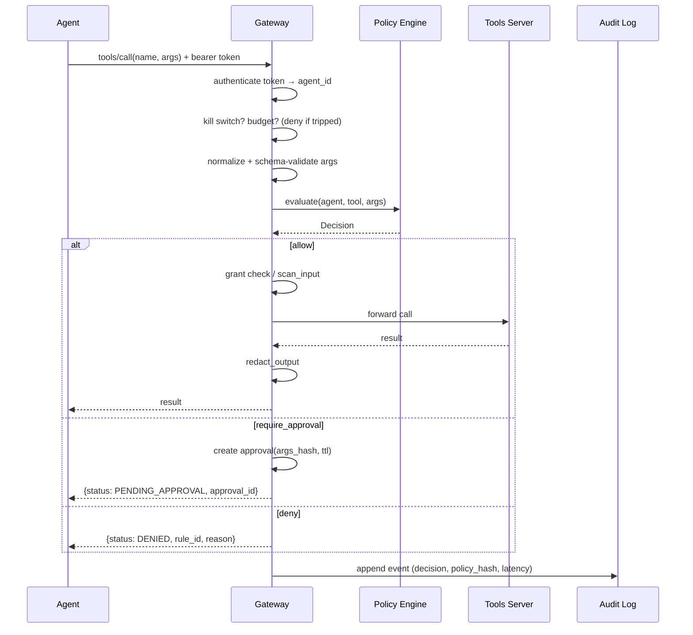

**Bastion Kit · ARCHITECTURE.md**

# Bastion v0.1: Architecture

These decisions are fixed. To change one, add an ADR in `docs/adr/` and note it in PROGRESS → Decisions.

## 1. System context


## 2. Runtime topology (ADR-001: single container)
One container, two processes run by `honcho` from a `Procfile`:
- `api`: `uvicorn bastion.api.main:app --port 8000`. The FastAPI app **mounts the MCP gateway** (FastMCP streamable-HTTP app) at `/mcp`. It runs agent scenarios as background tasks.
- `console`: `streamlit run src/bastion/console/app.py --server.port $PORT`. It talks to the API at `http://127.0.0.1:8000`.
- The demo tools MCP server is **spawned by the gateway over stdio** (`python -m demo.tools_server`).

Fallback: if mounting FastMCP inside FastAPI is awkward in the installed `mcp` version, run the gateway as a third Procfile process on port 8100 and record the change as an ADR.

## 3. Repository layout
```
bastion-agent-governance/
  CLAUDE.md  README.md  LICENSE  SECURITY.md  Makefile  pyproject.toml  Procfile
  Dockerfile  docker-compose.yml  railway.json  .env.example  .gitignore
  .pre-commit-config.yaml  .github/workflows/ci.yml  .github/dependabot.yml
  .claude/settings.json  .claude/agents/
  config/prices.yaml  config/settings.example.yaml
  docs/ SPEC.md ARCHITECTURE.md USE_CASES.md EVALS.md GOVERNANCE_MAPPING.md
        SLICES.md PROGRESS.md VERIFY.md THREAT_MODEL.md DEMO_SCRIPT.md SHOWCASE.md adr/
  policies/  templates/{high,limited,minimal}.yaml  loan-ops-agent.yaml
  knowledge/  (short paraphrased summaries: EU AI Act Art.5, Art.6, Annex III, Art.50; all [VERIFY])
  src/bastion/
    config.py
    llm/        client.py (GovernedAnthropic + replay/record/live), fixtures.py
    gateway/    mcp_proxy.py  policy_engine.py  conditions.py  normalize.py  redaction.py  budgets.py
    registry/   models.py  service.py  assessor_graph.py
    oversight/  approvals.py  killswitch.py
    audit/      log.py  verify.py
    incidents/  rules.py  service.py
    evidence/   generator.py  templates/pack.html.j2  pdf.py
    api/        main.py  routers/*.py  auth.py
    console/    app.py  pages/*.py
    db.py  models.py  cli.py
  demo/
    data/generate.py  (Faker, seed=42 → 50 customers, notes incl. injection payloads)
    tools_server/__main__.py  (FastMCP)
    loan_ops_agent/graph.py  run.py  scenarios.py
  evals/  redteam/*.yaml  benign/*.yaml  assessor/cards/*.yaml  run.py  thresholds.yaml  results/
  fixtures/llm/*.json
  scripts/make_gif.py  scripts/update_readme_results.py
  tests/
```

## 4. Data model (SQLAlchemy 2.0, SQLite WAL)
| Table | Key fields |
|---|---|
| `agents` | id (slug), name, owner, status (`draft`/`assessing`/`awaiting_signoff`/`active`/`killed`/`blocked`), tier, token_hash, created_at |
| `agent_cards` | agent_id, version, card_json |
| `assessments` | id, agent_id, assessor_json, reviewer_json, revised_json, final_tier, signed_off_by, override_reason, signed_at |
| `policies` | id, agent_id (nullable for templates), version, content_yaml, content_hash, active, created_by, created_at |
| `runs` | id, agent_id, scenario, status, thread_id (LangGraph), started_at, ended_at |
| `approvals` | id, agent_id, run_id, tool, args_hash, args_redacted_json, status (`pending`/`approved`/`rejected`/`expired`/`revoked`/`consumed`), decided_by, reason, expires_at |
| `incidents` | id, agent_id, severity, rule_id, status, summary, notes_json, opened_at, closed_at |
| `usage` | agent_id, run_id, kind (`model`/`tool`), tokens_in, tokens_out, cost_usd, ts |
| `killswitch` | scope (`global`/agent_id), active, reason, actor, ts |
| `audit_events` | seq (PK, autoincrement), ts, actor, event_type, agent_id, payload_json, prev_hash, hash |

## 5. Policy DSL
```yaml
agent: loan-ops-agent
version_note: "initial policy"
downstream:
  - name: loan-tools
    command: ["python", "-m", "demo.tools_server"]
budgets:
  max_tool_calls_per_session: 30
  max_tokens_per_session: 200000
  max_cost_usd_per_day: 5.0
incident_rules:
  - id: IR-1
    when: "deny_count_10m >= 3"
    severity: medium
  - id: IR-2
    when: "category == 'exfiltration'"
    severity: high
    on_incident: kill
rules:                      # ordered; first match wins; no match => deny
  - id: R-001
    tool: lookup_customer
    effect: allow
    redact_output: [EMAIL_ADDRESS, PHONE_NUMBER, IBAN_CODE]
  - id: R-002
    tool: get_customer_notes
    effect: allow
    redact_output: [EMAIL_ADDRESS, PHONE_NUMBER]
  - id: R-003
    tool: update_credit_limit
    effect: require_approval
    when: "args.new_limit > 50000 or pct_change(args.current_limit, args.new_limit) > 20"
  - id: R-004
    tool: update_credit_limit
    effect: allow
  - id: R-005
    tool: send_email
    effect: allow
    when: "endswith(args.to, '@bank.example')"
    scan_input: { entities: [IBAN_CODE, CREDIT_CARD], action: require_approval }
  - id: R-006
    tool: send_email
    effect: require_approval
  - id: R-007
    tool: export_customer_data
    effect: deny
    category: exfiltration
```
- **Conditions (ADR-003):** a custom, small **AST-based evaluator**. Never use `eval`. It supports literals, `and/or/not`, comparisons, arithmetic, `in`, attribute access on the `args` namespace only, and the whitelisted functions `len, lower, startswith, endswith, contains, pct_change, now_hour`. Context names: `args`, `agent`, `tier`, `deny_count_10m`, `category`. Unknown names or functions raise an error, and the decision becomes `deny` with reason `condition_error`. Target 100% branch coverage on this module.
- Every decision returns `Decision(effect, rule_id, policy_hash, reasons[], redactions[])` and is audited.

## 6. Key flows

### 6.1 Tool call through the gateway


### 6.2 Approval (ADR-002: args-bound single-use grants)
1. The gateway returns `PENDING_APPROVAL`. The agent graph calls LangGraph `interrupt()`, and state is persisted via the SQLite checkpointer.
2. The approver decides in the console, which calls `POST /approvals/{id}/decision`.
3. If approved: a grant is stored for `(agent_id, tool, args_hash)`, single use, expiring at TTL. The API resumes the run (`Command(resume=...)`).
4. The agent re-issues **the identical call**; the gateway finds and consumes the grant and forwards the call. Any argument change produces a new hash and a new approval.

### 6.3 Kill switch
`POST /agents/{id}/kill` → `killswitch` row active → the gateway denies all calls for the agent (checked first) → pending approvals are set to `revoked` → active runs are marked `halted` → an incident is opened if none is open → audited. Reactivating requires a reason.

### 6.4 Registration and classification
LangGraph: `load_card → retrieve(knowledge/) → assess (structured output, smart model) → review (structured output, smart model) → [disagree? revise once] → interrupt(await_signoff)`. Sign-off picks a policy template by tier, activates the policy and issues the token.

## 7. LLM client and replay (ADR-004)
- `GovernedAnthropic(agent_id, mode)` wraps `anthropic.Anthropic().messages.create`. Before each call it runs a budget check and the kill-switch check; after each call it records usage (tokens, cost from `config/prices.yaml`) and appends an audit event.
- **Fixture key:** `sha256(canonical_json({model, system, messages, tools, tool_choice, temperature, max_tokens}))`. Fixtures are stored at `fixtures/llm/<key>.json` and contain the response plus usage.
- Modes: `replay` (a miss raises `ReplayMissError` with a hint to run `make record`), `record`, `live`. Default `replay`. CI forces `replay`.
- Use `temperature=0` for all agent calls so recordings stay stable.

## 8. Identity and security
- Agent tokens are 32 random bytes, url-safe, shown once and stored as an sha256 hash. Sent as `Authorization: Bearer` on MCP HTTP.
- The console's mutating actions and live mode require `BASTION_PASSCODE` (constant-time compare). In replay mode the public demo still lets visitors run the **pre-recorded scenarios**.
- Threat model in `docs/THREAT_MODEL.md` (STRIDE over the agent → gateway → tool path; injection; approval replay; audit tamper; budget exhaustion; policy tampering).

## 9. Evidence pack (ADR-006: Playwright for PDF and GIF)
Jinja2 → HTML → Playwright Chromium `page.pdf(display_header_footer=True)`. The header template shows the document name; the footer template shows `Page <span class="pageNumber"></span> of <span class="totalPages"></span>`. The same Playwright install drives `scripts/make_gif.py`, which scripts the console, takes screenshots and assembles them into `docs/assets/demo.gif` with Pillow.

## 10. Configuration (pydantic-settings)
| Env var | Default |
|---|---|
| `BASTION_MODE` | `replay` |
| `ANTHROPIC_API_KEY` | (unset) |
| `BASTION_PASSCODE` | (unset → mutating actions disabled in public mode) |
| `BASTION_DB_PATH` | `./data/bastion.db` |
| `BASTION_MODEL_FAST` | `claude-haiku-5-5` |
| `BASTION_MODEL_SMART` | `claude-sonnet-5-5` |
| `BASTION_API_URL` | `http://127.0.0.1:8000` |
| `BASTION_LOCAL_DEV` | `false` (`make serve` sets it: with no passcode configured, the local passcode `bastion-local` is accepted; see ADR-008) |
| `BASTION_SEED_ON_START` | `true` (seed demo agent, policy and data if the DB is empty) |

## 11. Libraries
`mcp` (FastMCP server + client), `anthropic`, `langgraph`, `langgraph-checkpoint-sqlite`, `fastapi`, `uvicorn`, `pydantic`, `pydantic-settings`, `sqlalchemy`, `presidio-analyzer`, `presidio-anonymizer` (spaCy `en_core_web_sm`, configured explicitly), `jinja2`, `playwright`, `pillow`, `streamlit`, `httpx`, `faker`, `typer`, `pyyaml`, `honcho`; dev: `pytest`, `pytest-cov`, `ruff`, `pre-commit`.

## 12. Initial ADRs to write in S0
ADR-001 single container · ADR-002 args-bound approval grants · ADR-003 custom condition evaluator · ADR-004 LLM replay fixtures · ADR-005 SQLite WAL + SQLAlchemy · ADR-006 Playwright for PDF and GIF.

---
*ARCHITECTURE.md · Page 1 of 1*
