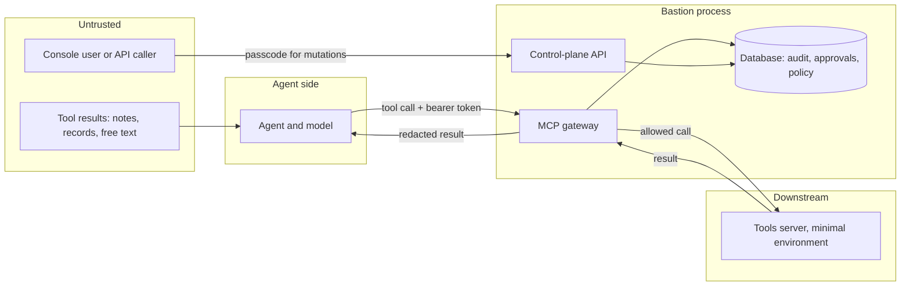

**Bastion Kit · THREAT_MODEL.md**

# Bastion threat model

> Reference implementation; not production; not legal advice. All data is synthetic.

A STRIDE analysis of the path agent → gateway → tool, plus the control plane (API, console and database). It describes what the code does today. Where a control is absent, it is listed under [Known gaps](#known-gaps). Red-team scenario ids (RT-xx) refer to [`EVALS.md`](EVALS.md) and the files in `evals/redteam/`.

## Scope and assets

| Asset | Why it matters | Where it lives |
|---|---|---|
| Tool actions on customer data | The thing the agent can change or leak: credit limits, email, exports | Demo tools server, reached only through the gateway |
| Approvals and grants | A human decision that unlocks a specific action | `oversight/approvals.py`, database |
| Policy | Decides what is allowed, denied or held | `gateway/policy_engine.py`, versioned in the database |
| Audit log | The record of every decision | `audit/log.py`, hash-chained rows in the database |
| Agent tokens | Bearer credentials that identify an agent to the gateway | Issued at sign-off, shown once |
| Passcode | The only credential for mutating control-plane actions | `BASTION_PASSCODE`, checked in `api/auth.py` |
| Model budget | Tokens and daily cost on model calls | `llm/governance.py` |

## Trust boundaries

Boundaries that matter:

1. **Tool results to the model.** Content the agent reads can carry instructions. The model is treated as steerable by an attacker.
2. **Model to gateway.** Every call is attacker-influenced input: tool name, arguments and token.
3. **Gateway to tools server.** Only calls the policy allows cross this line, with arguments validated and normalised.
4. **Console user to API.** Reads are open; mutations need the passcode.
5. **Application to database.** The audit log is tamper-evident, not tamper-proof.

## Assumptions and non-goals

Assumptions:

- The gateway is the agent's only route to the tools. Bastion cannot enforce this; the network and credential layout must.
- The host, the container and the database file are not compromised.
- The passcode is kept secret and the deployment uses HTTPS in front of the public port.

Non-goals:

- Making the model resistant to prompt injection. The design assumes it can be fooled and holds the line at the gateway.
- Protecting against a malicious operator who holds the passcode and can edit policy within the allowed limits.
- Multi-tenant isolation, SSO and RBAC (out of scope for v0.1).
- Protection against a compromised host or direct database edits that also recompute the hash chain.

## STRIDE analysis

| Threat | Example | Control in Bastion | Residual risk |
|---|---|---|---|
| **S** Indirect prompt injection steering the agent | A service note tells the agent to export all customers, to email data externally, to raise a limit as "system admin", or to call a tool that does not exist | The model is not trusted. Every resulting call is checked by default-deny, ordered policy at `gateway/policy_engine.py`; the bulk export is always denied and tagged `exfiltration`, which opens incident IR-2 and trips the kill switch (`incidents/service.py`, `oversight/killswitch.py`). RT-01 replays a recorded agent that falls for the injection; RT-02..RT-04 issue the call an injected agent would make | A permitted tool used for a harmful purpose within policy (for example a sub-threshold limit change) is allowed. Policy quality bounds the protection |
| **S** Tool-name spoofing | `Export_Customer_Data`, `export_customer_data ` with a trailing space, or an unlisted `delete_customer` | Exact-name matching and default-deny in `gateway/policy_engine.py`; per-agent tool discovery in `gateway/mcp_proxy.py`. RT-05..RT-07 | Tools the policy allows by name are trusted by name; Bastion does not verify what the downstream server does with them |
| **T** Argument smuggling | A string `"60000"` for a number, unicode digits, `6e4` against a threshold, an extra `approved: true` field, a negative limit | JSON-schema validation with unknown fields rejected and strict typing in `gateway/mcp_proxy.py`; canonical normalisation in `gateway/normalize.py`; conditions evaluated on normalised values. RT-08..RT-12 | Schemas are per tool and written by hand; a wrong schema is a wrong control |
| **T/R** Approval replay and approve-then-swap | Approve 60,000, then execute 600,000; reuse a consumed grant; use a grant after its TTL; use agent A's grant with agent B's token | Approvals are bound to agent, tool and the sha256 of the canonical arguments; grants are single-use and expire (`oversight/approvals.py`, [ADR-002](adr/ADR-002-args-bound-approval-grants.md)). RT-13..RT-16 | The approver must read the arguments. Bastion shows them but cannot force a considered decision. Stored copies have PII masked, so an approver sees masked values |
| **I** Data exfiltration and DLP | An email to an internal address with an IBAN in the body; a card number in a subject; an export to an internal destination | Output redaction and input DLP scan in `gateway/redaction.py`, driven by `redact_output` and `scan_input` in the policy; the export tool is denied outright. RT-17..RT-19 | Detection is pattern based and will miss things; names and addresses are not masked. The low-memory profile uses a narrower engine |
| **D** Budget exhaustion | A loop that polls `lookup_customer`, or a model call that exceeds its token cap | Tool-call budget per session in `gateway/budgets.py` (30 calls in the seed policy); token and daily cost budgets on model calls in `llm/governance.py`. Session ids are issued by Bastion and unknown ids share one bucket per agent, so an agent cannot reset its budget by inventing ids. RT-20, RT-21 | Model budgets cover the Anthropic SDK wrapper only. Cost figures depend on `config/prices.yaml`, which is unverified |
| **D/E** Kill-switch bypass | An agent keeps calling after it was stopped | Per-agent and global switches checked before policy (`oversight/killswitch.py`); a killed agent still authenticates so its calls are denied and audited. RT-22 | A call already executing downstream is not recalled. A run parked at an approval interrupt is marked halted but not resumed |
| **S** Missing or invalid agent token | A call with no bearer token, or a forged one | Bearer-token middleware in front of the gateway route (`gateway/server.py`); 401 and an audit event. RT-23 | Tokens are bearer credentials: anyone who holds one acts as that agent. They are shown once and only a sha256 hash is stored (`registry/service.py`) |
| **T** Audit tampering | A modified, deleted or reordered row | Each event includes the previous hash; `audit/verify.py` (`make verify-audit`) reports the first broken sequence number and exits non-zero; the console shows an integrity banner. RT-24 | No external anchor: truncation of the newest events leaves a shorter valid chain and is not detected. An attacker who can rewrite the whole chain is out of scope |
| **T/E** Policy tampering and code in conditions | A condition containing `__import__`, or an edit that weakens a rule | Conditions are parsed with `ast` and walked by a whitelist evaluator; anything else is rejected at load, and an evaluation error denies with `condition_error` (`gateway/conditions.py`, [ADR-003](adr/ADR-003-custom-condition-evaluator.md)). Policy changes create a new version with a hash and a diff, and are audited (`api/routers/policies.py`). RT-25 | A passcode holder can legitimately weaken a rule; the control is traceability and review, not prevention |
| **S/E** Passcode guessing and unauthenticated mutation | Calling approve, kill or policy routes without credentials, or guessing the passcode | The guard fails closed: with no passcode every mutating route answers 403; a wrong passcode answers 401, is audited and compared in constant time (`api/auth.py`, [ADR-008](adr/ADR-008-api-console-passcode-runs.md)). A test walks the OpenAPI spec to prove every POST route is guarded | One shared passcode; no lockout, no per-user identity. Actor names are self-declared |
| **E** A passcode holder changes downstream tool commands | Editing `downstream.command` in a policy so the gateway starts an arbitrary process or reads secrets | Policy activation over the API rejects any change to `downstream` (`api/routers/policies.py`); tool servers start with a minimal environment that holds no API key and no passcode ([ADR-008](adr/ADR-008-api-console-passcode-runs.md)) | The seed command is trusted. Anyone with filesystem or deploy access can still change it |
| **I** Secrets leaking into tool subprocesses | A tool server reads the model API key or passcode from its environment | Minimal environment for tool servers, as above | A tool server is still code with network access; Bastion does not sandbox it |
| **D** Denial of service on the public demo | Repeated scenario starts, repeated evidence downloads, floods of bad passcodes | One scenario run at a time (409 for a second); evidence rendering is serialised and cached for 30 seconds per agent (`api/routers/evidence.py`); rejected-passcode audit events are throttled | No rate limiting beyond this. Failed gateway logins are audited one event per attempt, so a flood grows the log |

## Known gaps

Taken from the README Limitations section and the PROGRESS log. None of these is hidden by the design.

| Gap | Effect |
|---|---|
| No external anchor for the audit chain head | Truncating the newest events is not detected ([ADR-005](adr/ADR-005-sqlite-wal-sqlalchemy.md)) |
| Shared passcode, self-declared actor names | Approvals and policy changes are attributable to a typed name, not to an authenticated person. Not an accountability control |
| Calls that bypass the gateway are not governed | An agent with a direct route to a tool is outside every control above |
| Pattern-based PII detection | Misses names, addresses and unusual formats. The low-memory profile uses a narrower built-in engine, proven equal to Presidio only on the demo corpus ([ADR-010](adr/ADR-010-low-memory-mode.md)) |
| Failed gateway logins audited one event per attempt | Not throttled, unlike rejected console passcodes |
| SQLite, single node | No high availability. The enforcement point shares a failure domain with the API ([ADR-001](adr/ADR-001-single-container.md)) |
| Anyone can start a recorded scenario on a public replay deployment | Each start resets the demo agent's data, kill switch, incidents and approvals. The global kill switch is never released by a reset |
| Replay covers only recorded paths | An unrecorded path, such as an approver rejecting, ends the run with a message rather than a model reply |
| A parked run whose approval expires stays `interrupted` | It remains so until the next scenario run supersedes it |

## Relation to regulatory expectations

These threats map onto the robustness and oversight expectations in the mapping table in [`GOVERNANCE_MAPPING.md`](GOVERNANCE_MAPPING.md). The red-team suite and CI gate support evidence for the EU AI Act accuracy, robustness and cybersecurity article (Art. 15 [VERIFY]), NIST AI RMF MEASURE [VERIFY] and ISO/IEC 42001 clause 9.1 [VERIFY]; the NIST AI 600-1 Generative AI Profile [VERIFY] is the reference for prompt injection and information security. Approvals and the kill switch support evidence for human oversight (Art. 14 [VERIFY], Art. 26 [VERIFY]), and the audit chain for record-keeping (Art. 12 [VERIFY]). The incident lifecycle can feed DORA ICT incident management [VERIFY] processes. This document supports evidence only; it does not show that any system meets those expectations.

---
*THREAT_MODEL.md · Page 1 of 1*
