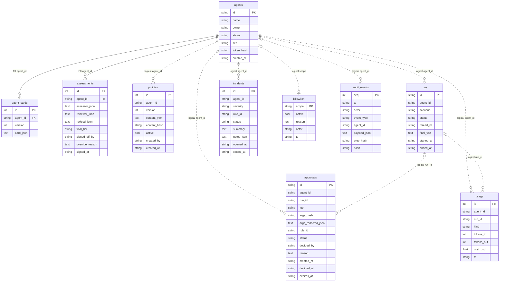
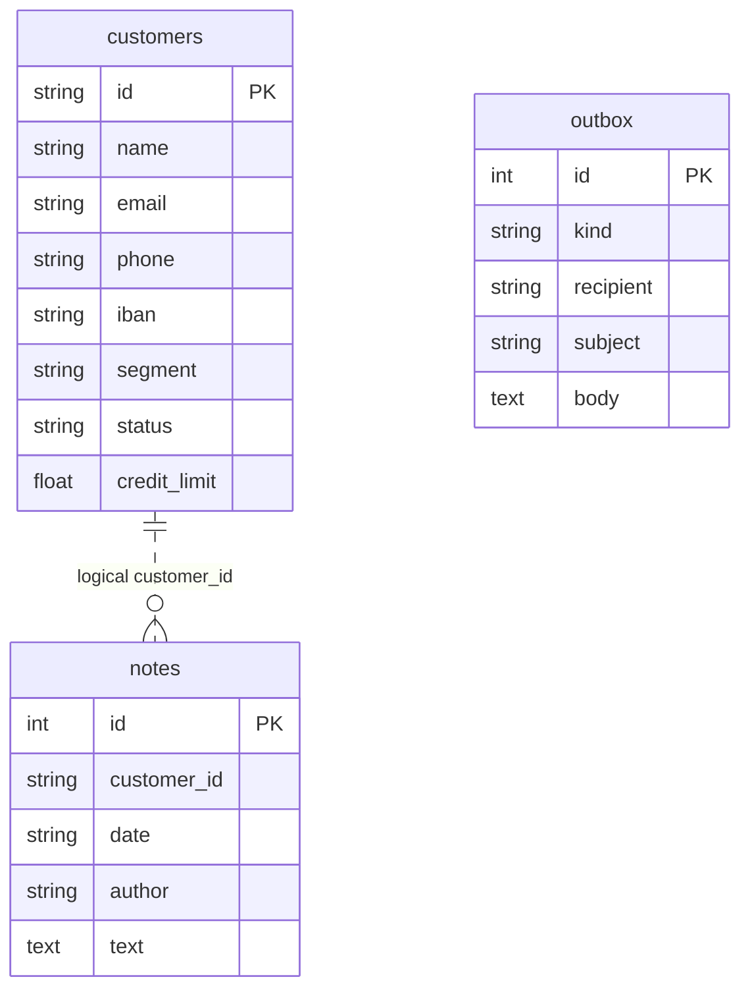

**Bastion Kit · design/DATA_MODEL**

# Data model

> Reference implementation; not production; not legal advice.

This document describes the tables Bastion stores, the invariants the code maintains and where each is enforced and tested. It was written from `src/bastion/models.py`, `src/bastion/db.py` and the modules that write each table. Where it differs from `docs/ARCHITECTURE.md` §4, the code is described. Regulatory references carry `[VERIFY]` and are listed in `docs/VERIFY.md`.

## 1. Overview

Bastion uses three SQLite files. They sit side by side in one data directory (`Path(settings.db_path).parent`, default `./data`), and none has a database-level link to another.

| File | Owner | What it holds | Schema defined in |
|---|---|---|---|
| `bastion.db` (`BASTION_DB_PATH`) | Bastion | Agents, cards, assessments, policy versions, runs, approvals, incidents, usage, kill switches and the audit log | `src/bastion/models.py`; created by `make_engine` with `Base.metadata.create_all` |
| `demo.db` | The fictional bank | Synthetic `customers`, `notes` and `outbox`. It stands in for the bank's own system, which Bastion does not own | `SCHEMA` in `demo/data/generate.py` |
| `checkpoints.db` | LangGraph | The Loan Ops Agent's graph state, keyed by `thread_id`, which equals the run id | The library (`AsyncSqliteSaver`); not defined in this repository |

Notes:

- `make_engine` runs `create_all` at start-up. I found no migration tooling in the repository, so a change to a column needs a new database.
- `make demo` and the agent-layer evals run in a temporary directory that is deleted at exit (`DemoEnvironment`, `run_all`). The API server keeps its three files in the data directory.
- Timestamps in `bastion.db` are ISO-8601 UTC strings with microseconds (`iso()` in `models.py`), stored as `String`. Boolean columns are SQLite integers.
- The checkpoint database stores the agent's conversation and its pending tool inputs as the agent produced them. Tool results in it have already been through the gateway's redactor; the pending inputs have not been through it.

## 2. Bastion tables

Solid lines are real foreign keys, declared with `ForeignKey` and enforced because `make_engine` sets `PRAGMA foreign_keys=ON`. Dotted lines are logical references: the column holds an id by convention, nothing in the database checks it.

Only two foreign keys exist: `agent_cards.agent_id` and `assessments.agent_id`, both to `agents.id`. Every other `agent_id`, `run_id` and `scope` is logical. Logical references are deliberate in places: `usage.run_id` can be `unbound`, `killswitch.scope` can be `global`, and the audit log must accept events for ids that have no agent row (for example `auth_failed`).

Indexes declared in `models.py`: `agents.token_hash`; `agent_id` on `agent_cards`, `assessments`, `policies`, `runs`, `approvals`, `incidents`, `usage` and `audit_events`; `usage.run_id`; `audit_events.event_type`; and the composite `ix_approvals_lookup` on `approvals (agent_id, tool, args_hash, status)`, which serves the grant lookup.

## 3. Table reference

### 3.1 `agents`

Purpose: one row per registered agent; holds its lifecycle status, signed-off tier and token hash.

Key fields: `id` (a slug; `global` and `unbound` are reserved), `status`, `tier`, `token_hash` (sha256 of the token; the token itself is never stored).

Written by:

- `Registry.create_agent` (`src/bastion/registry/service.py`): inserts the row. Called by `ClassificationService.submit_card` and `seed_demo`.
- `ClassificationService._set_status` and `run_assessment`: `assessing` and `awaiting_signoff`.
- `ClassificationService.sign_off`: a conditional update to `active` or `blocked`, and sets `tier`.
- `Registry.issue_token`: sets `token_hash`.
- `KillSwitchService.kill` and `reactivate`: `active` to `killed` and back.

| Status | Meaning |
|---|---|
| `draft` | Card submitted; no credential exists |
| `assessing` | The Assessor and Reviewer are running |
| `awaiting_signoff` | A proposal is stored; a human has not decided |
| `active` | Signed off at a tier other than `prohibited`; has a policy and a token |
| `killed` | A kill switch is active for this agent or globally |
| `blocked` | Signed off as `prohibited`; no policy and no token |

`Registry.authenticate` accepts `active` and `killed` agents. A killed agent still authenticates so that its calls are denied and recorded rather than appearing as anonymous 401s.

### 3.2 `agent_cards`

Purpose: the card an owner submitted, as JSON validated by the `AgentCard` model.

Key fields: `agent_id`, `version`, `card_json`. Written by `ClassificationService.submit_card`, which always writes version 1. `get_card` reads the highest version, but no code writes a later one.

### 3.3 `assessments`

Purpose: the classification record: the Assessor's proposal, the Reviewer's critique, the optional revision and the human decision.

Key fields: `assessor_json`, `reviewer_json`, `revised_json` (the `Assessment` and `Review` models), `final_tier`, `signed_off_by`, `override_reason`, `signed_at`.

Written by `ClassificationService.run_assessment` (inserts a row with the three JSON fields) and `sign_off` (fills `final_tier`, `signed_off_by`, `signed_at` and `override_reason` on the newest row for the agent). An agent in `awaiting_signoff` can be assessed again, which adds a row; reads use the highest `id`. An unsigned row has `final_tier` null.

### 3.4 `policies`

Purpose: every version of an agent's policy, as the YAML text and its hash, with one marked active.

Key fields: `agent_id`, `version` (1, 2, 3, ... per agent), `content_yaml`, `content_hash` (sha256 of the text), `active`, `created_by`.

Written by `PolicyStore.activate`, called from `ClassificationService.sign_off`, `seed_demo`, the policies API route and the evals. Old versions are kept. The column is nullable in the model, and `docs/ARCHITECTURE.md` §4 says null is for templates; no code writes a null `agent_id`, and templates are files under `policies/templates/`.

### 3.5 `runs`

Purpose: one row per agent run (session). The run id is the budget bucket for tool calls and model tokens and is the LangGraph `thread_id`.

Key fields: `agent_id`, `scenario`, `status`, `thread_id`, `final_text`, `started_at`, `ended_at`.

Written by `Registry.start_run`, `set_run_status`, `set_run_text` (called from `AgentRunner` and `RunManager`) and `KillSwitchService.kill`, which sets `halted` directly.

| Status | Meaning |
|---|---|
| `running` | Started or resumed |
| `interrupted` | Paused at an approval |
| `completed` | The agent finished. `max_steps` is recorded as `completed` |
| `halted` | Stopped by the kill switch, a governance block on a model call, or superseded by a new scenario run |
| `failed` | The background task raised an exception |

`ended_at` is set for `completed`, `halted` and `failed`. `final_text` is the agent's closing text; it is model output and is not redacted.

### 3.6 `approvals`

Purpose: human approvals bound to an exact call. The row is the request, the decision and the grant: there is no separate grants table, and `docs/ARCHITECTURE.md` §6.2 describes the grant as stored, which in the code is an approval with status `approved`.

Key fields: `id`, `agent_id`, `tool`, `args_hash`, `args_redacted_json` (arguments masked with all supported entities), `rule_id`, `status`, `decided_by`, `reason`, `expires_at` (30 minutes after creation by default, `DEFAULT_TTL_SECONDS`). `created_at`, `decided_at` and `rule_id` are in the code but not in `docs/ARCHITECTURE.md` §4. `run_id` is null when the call was in the `unbound` bucket.

Written by `ApprovalStore.request` (insert, or return the existing unexpired pending row for the same call) and `ApprovalService`: `decide`, `consume_grant`, `expire_stale` (called inside `decide`, `consume_grant` and `all`) and `revoke_open` (kill switch).

| Status | Meaning |
|---|---|
| `pending` | Waiting for a decision |
| `approved` | A human approved; the grant is unused |
| `rejected` | A human declined |
| `expired` | A pending approval or an unused grant passed `expires_at` |
| `revoked` | Revoked by the kill switch (pending or unused) |
| `consumed` | The grant was used by the identical call; terminal |

### 3.7 `incidents`

Purpose: incidents opened by policy rules or the kill switch, worked through a fixed lifecycle.

Key fields: `agent_id`, `severity`, `rule_id` (an incident rule such as IR-1 or IR-2, or `KILLSWITCH`), `status`, `summary`, `notes_json` (a JSON list of `ts`, `actor`, `status`, `note`), `opened_at`, `closed_at`.

Written by `IncidentService.open` and `advance`. `open` is called by `IncidentService.evaluate_rules` (from `Gateway._run_incident_rules`) and by `KillSwitchService.kill`.

| Status | Meaning |
|---|---|
| `open` | Raised; nobody has acknowledged it |
| `acknowledged` | A person has seen it (note required) |
| `contained` | The cause is stopped |
| `resolved` | Closed; `closed_at` is set |

### 3.8 `usage`

Purpose: the ledger behind budgets and the usage view. One row per model call or tool call.

Key fields: `agent_id`, `run_id` (a run id, or `unbound`), `kind` (`model` or `tool`), `tokens_in`, `tokens_out`, `cost_usd`, `ts`.

Written by `GovernanceHook.after_call` (`kind="model"`, from `src/bastion/llm/governance.py`) and `BudgetTracker.record_tool_call` (`kind="tool"`, zero tokens and cost, from `src/bastion/gateway/budgets.py`). The tool row is written after the kill switch, tool-name, policy-load and budget checks pass and before argument validation and policy evaluation, so a call later denied by a rule still counts toward the session cap.

### 3.9 `killswitch`

Purpose: kill switch state per scope, `global` or an agent id.

Key fields: `scope`, `active`, `reason`, `actor`, `ts`. Written by `KillSwitchService.kill` and `reactivate`. A row persists after reactivation with `active` false; it records the last change, and the history is in the audit log.

### 3.10 `audit_events`

Purpose: the append-only, hash-chained log of everything that governs or changes state.

Key fields: `seq`, `ts`, `actor`, `event_type`, `agent_id`, `payload_json` (canonical JSON), `prev_hash`, `hash`. `hash` is the sha256 of `prev_hash` followed by the canonical JSON of `seq`, `ts`, `actor`, `event_type`, `agent_id` and the payload. The first event links to `GENESIS_HASH`, 64 zeros. `seq` is assigned by `AuditLog.append`, not by SQLite; `docs/ARCHITECTURE.md` §4 describes it as autoincrement.

Written only by `AuditLog.append` (`src/bastion/audit/log.py`). Event types written in `src/bastion`:

| Group | Event types |
|---|---|
| Registry and classification | `agent_registered`, `agent_card_submitted`, `assessment_completed`, `signoff_recorded`, `token_issued`, `policy_activated` |
| Runs | `run_started`, `run_status` |
| Gateway | `tool_decision`, `auth_failed` |
| Approvals | `approval_requested`, `approval_decided`, `grant_consumed`, `approval_revoked` |
| Kill switch and incidents | `killswitch_activated`, `killswitch_reactivated`, `incident_opened`, `incident_updated` |
| Model calls | `model_call`, `model_call_blocked` |
| API and evidence | `passcode_rejected`, `evidence_generated` |

## 4. Invariants

The database enforces little by itself: SQLite constraints cover primary keys and the two foreign keys. The invariants below are enforced in code. "Test" names the test that exercises it; where I found none, I say so.

| Invariant | Enforced in | Test |
|---|---|---|
| The audit log is gapless and hash-linked: each event's `seq` is the previous plus one and its `prev_hash` is the previous `hash` | `AuditLog.append` reads the head and inserts in one `BEGIN IMMEDIATE` transaction. `verify_chain` (`src/bastion/audit/verify.py`) checks sequence, link and recomputed hash | `tests/test_audit.py`: `test_chain_links_and_verifies`, `test_rt24_tampering_is_detected_at_the_first_broken_event`, `test_reordering_is_detected`, `test_recomputing_one_hash_still_breaks_the_next_link`, `test_concurrent_appends_keep_one_unbroken_chain` |
| Tampering is evident, not prevented. Truncating the newest events leaves a shorter valid chain | SQLite cannot make a table append-only (ADR-005). The head hash would have to be recorded elsewhere | Not detectable by design; documented in ADR-005 |
| At most one active policy per agent | `PolicyStore.activate` clears `active` on every row for the agent and inserts the new active row in one transaction. There is no unique index | `test_policy_change_is_versioned_and_decisions_reference_the_new_hash` checks that versions are retained. I found no test that asserts exactly one active row |
| The active policy text matches its recorded hash | `PolicyStore.active` recomputes `content_hash` and raises `PolicyLoadError` on mismatch; the gateway then denies every call with `condition_error` | `tests/test_gateway.py`: `test_policy_text_not_matching_its_hash_denies_everything`, `test_rt25_tampered_policy_row_denies_everything` |
| An invalid policy cannot be activated; nothing is stored | `Policy.from_yaml` runs before any write in `PolicyStore.activate` | `test_rt25_policy_with_code_in_a_condition_cannot_be_activated` |
| The agent token is stored only as a sha256 hash; the token is shown once and never written to the audit log | `Registry.issue_token`, `hash_token` | `tests/test_registry.py::test_token_is_shown_once_and_only_its_hash_is_stored`; `test_uc01_demo_agent_is_classified_high_and_signed_off_in_replay` |
| No token before sign-off, and none for a blocked agent | `Registry.issue_token` requires `status == "active"`; `authenticate` accepts only `active` and `killed` | `test_no_token_before_sign_off`, `test_blocked_agent_cannot_authenticate`, `test_prohibited_blocks_registration` |
| Approval ids are deterministic: `APR-` plus ten hex characters of sha256 over agent, tool, args hash and the count of earlier approvals for that triple | `ApprovalStore.request`. The reason is replay: model fixtures contain the id, so it must be the same on a fresh database | Indirect: the UC-04 replay in `tests/test_demo_scenarios.py` would miss its fixture if ids changed. `test_rt14_consumed_grant_cannot_be_reused` shows a repeat gets a different id. No test asserts the format directly |
| An unexpired pending approval for the same agent, tool and arguments is reused, not duplicated | `ApprovalStore.request` | I found no dedicated test |
| A consumed grant cannot be reused | `ApprovalService.consume_grant` runs a conditional `UPDATE ... WHERE status = 'approved'`; a second call finds no approved row and gets a new pending approval | `tests/test_oversight.py::test_rt14_consumed_grant_cannot_be_reused` |
| A grant applies only to the exact agent, tool and normalised arguments | Grant lookup keys on `(agent_id, tool, args_hash)`; `args_hash` is the sha256 of the normalised arguments (`src/bastion/gateway/normalize.py`) | `test_rt13_uc05_approve_then_swap_does_not_execute`, `test_rt16_grant_for_one_agent_is_useless_to_another`; `tests/test_normalize.py` for normalisation |
| A decision needs a reason and a pending approval; a revocation cannot be overwritten by a late decision | `ApprovalService.decide` uses a conditional update on `status = 'pending'` | `test_decisions_need_a_reason_and_a_pending_approval`; `test_rt22_uc07_kill_switch_denies_revokes_and_halts` |
| Grants expire | `expire_stale` | `test_rt15_grant_expires_after_ttl` |
| Reserved agent ids: `global` (kill switch scope) and `unbound` (shared budget bucket) cannot be agent ids | `AgentCard` field validator; `Registry.create_agent` | `tests/test_classification.py::test_reserved_names_cannot_be_agent_ids` |
| Client-supplied run ids cannot reset a budget: an unknown id, or another agent's run, maps to `unbound` | `Registry.resolve_run` | `tests/test_registry.py::test_runs_and_budget_buckets` |
| Sign-off is claimed once | `ClassificationService.sign_off`: `UPDATE ... WHERE status = 'awaiting_signoff'` and a row-count check | `tests/test_classification.py::test_sign_off_is_claimed_once` |
| Overriding the proposed tier needs a recorded reason | `sign_off` | `test_override_needs_a_reason` |
| One open incident per agent and rule; the lifecycle only moves forward, with a note | `IncidentService.open` returns the existing non-resolved incident; `advance` checks `LIFECYCLE` order | `test_ir1_opens_once_after_three_denials`, `test_incident_lifecycle_moves_forward_only_with_notes` |
| A kill switch needs a reason and a known agent; it revokes open approvals and halts open runs | `KillSwitchService.kill` | `test_kill_needs_a_reason_and_a_known_agent`, `test_rt22_uc07_kill_switch_denies_revokes_and_halts` |
| Foreign keys hold for `agent_cards` and `assessments` | `PRAGMA foreign_keys=ON` in `make_engine` | Not tested directly |

## 5. The demo bank database

`demo.db` is the fictional bank's customer system. It is generated by `demo/data/generate.py` with Faker (`en_GB`) and fixed seed 42: 50 customers (`C-0001` to `C-0050`), one to two notes each, and four planted notes (C-0013, C-0029, C-0035, C-0041) that carry synthetic indirect-injection text for the red-team scenarios. Limits for C-0007, C-0021 and C-0013 are fixed because the scripted scenarios depend on them. E-mails use `@example.com`, phones use a UK range reserved for fiction and IBANs are Faker test values. No table has a declared foreign key.

| Table | Purpose | Written by |
|---|---|---|
| `customers` | Customer profile. `segment` is `retail`, `premier` or `small-business`; `status` is `active` | `generate.build`; `update_credit_limit` in `demo/tools_server/__main__.py` changes `credit_limit` |
| `notes` | Free-text service notes, the channel for indirect injection | `generate.build` only; the tools server reads it |
| `outbox` | Stands in for sending. `kind` is `email` or `export` | `send_email` and `export_customer_data` in the tools server. Nothing leaves the machine |

The database stands in for the bank's own system. Bastion does not own it, never connects to it directly, and reaches it only through the tools server that the gateway spawns (the path is passed as `BASTION_DEMO_DB`).

Reset between scenarios: `generate.restore` generates the data once into `<db>.pristine` and copies it over `demo.db` using the SQLite backup API before every scenario, so each scenario starts from the same limits and an empty outbox. `isolate=True` (low-memory mode) generates in a short-lived subprocess. `reset_demo_state` in `demo/loan_ops_agent/run.py` also lifts the demo agent's own kill switch (never the global one), resolves its open incidents and revokes its open approvals. It does not delete audit events, usage rows, runs or earlier approvals, and it does not touch `checkpoints.db`.

## 6. Transactions and locking

`src/bastion/db.py` configures one SQLAlchemy engine per database file.

| Setting | Effect |
|---|---|
| `PRAGMA journal_mode=WAL`, `synchronous=NORMAL` | Readers do not block the writer |
| `PRAGMA foreign_keys=ON` | The two foreign keys are enforced |
| `isolation_level = None` on connect, and a `begin` event listener | The sqlite3 driver's implicit `BEGIN` is off; Bastion issues `BEGIN IMMEDIATE` when the connection has `execution_options(immediate=True)`, otherwise `BEGIN` |
| `timeout: 15`, `check_same_thread: False` | Writers wait up to 15 seconds for the lock; connections are shared across threads |

Three entry points:

- `session_scope(engine)` is a unit of work. It opens a session with `immediate=True`, so it takes the write lock at its first statement, commits on success and rolls back on any exception. Most units of work read and then write; a deferred transaction that does so can fail with "database is locked" when another connection commits in between, and the busy timeout does not apply to that upgrade. Taking the lock up front makes writers queue.
- `read_scope(engine)` is a deferred, read-only session that never takes the write lock. The gateway uses it for per-call lookups (`Registry.get_agent`, `authenticate`, `resolve_run`, `PolicyStore.active_row`, `KillSwitchService.active_scope`, `BudgetTracker.tool_calls`). Nothing may be written through it.
- `AuditLog.append` opens its own connection with `immediate=True` and reads the chain head and inserts the new row inside one `BEGIN IMMEDIATE` transaction. Two writers cannot read the same head, so the chain cannot fork.

Consequences:

- A service method writes its table and then appends its audit event in a separate transaction. The state change and its audit event are not atomic: a crash between them leaves a change with no event. `tests/test_audit.py::test_concurrent_read_then_write_units_of_work_do_not_fail_with_database_is_locked` covers the lock behaviour with eight threads, not crash recovery.
- SQLite has one writer at a time. This is acceptable for a demo and is not a production throughput design (ADR-005).
- `ApprovalStore.get` and several `all` methods use `session_scope` for reads, so they take the write lock; they are not on the gateway's hot path.

## 7. Retention notes

Bastion has no retention policy and no purge job. I searched `src` for delete statements and for retention or purge logic and found none. The notes below describe what the code does.

| Data | What happens |
|---|---|
| Audit events | Kept for the life of `bastion.db`. Nothing deletes or archives them. `verify_chain` is the integrity check |
| Policy versions | All kept; activation only clears the `active` flag |
| Approvals, incidents, runs, usage, assessments, cards | Kept. Demo resets change statuses (resolve incidents, revoke approvals, lift the kill switch); they do not delete rows |
| Kill switch | One row per scope, overwritten on each change; history is in the audit log |
| Demo bank data | Replaced from the pristine copy before each scenario; the outbox is emptied each time |
| Checkpoints | Written by LangGraph per run; no code removes them |
| Throwaway runs | `make demo` and the eval harness use a temporary directory removed at exit |
| Replay fixtures | Files in `fixtures/llm/`; deleted and re-recorded by `make record` |

Personal data in the audit log and other tables:

- `tool_decision` events record arguments masked by the gateway's redactor (`EMAIL_ADDRESS`, `PHONE_NUMBER`, `IBAN_CODE`, `CREDIT_CARD`). Coverage is that of the redaction engine in use (Presidio, or the pattern engine in low-memory mode, ADR-010); it is not a guarantee that every identifier is masked.
- Where arguments were rejected before validation or normalisation completed (kill switch, invalid tool name, no policy, budget, unknown tool, invalid arguments), `Gateway._audit_decision` records only the argument field names (`_fields`, sorted, each cut to 60 characters), not the values. `tests/test_gateway.py::test_invalid_argument_values_are_not_written_to_the_audit_log` asserts it.
- Approvals store `args_redacted_json`, masked with all supported entities, and the `args_hash`, which is a one-way hash of the normalised arguments.
- Free text is stored as written: approver reasons (`approvals.reason`, in the `approval_decided` event), incident notes, override reasons, agent cards and `runs.final_text`. None of it passes through the redactor.
- Tool results reach the model, and so the checkpoint database, only after redaction.

What a real deployment would need, none of which exists here:

- A written retention period for audit events, set against applicable log-retention duties for high-risk systems (Art. 12 and Art. 26 [VERIFY]) and data-protection requirements, including data minimisation (GDPR Art. 5(1)(c) [VERIFY]). Counsel decides the periods; this repository does not.
- Archival of the audit log to external, write-once storage, with the chain head anchored outside the database to close the truncation gap in ADR-005.
- A purge or archive job that respects the chain: deleting old events breaks `verify_chain` unless the log is checkpointed at a recorded head hash.
- Redaction or pseudonymisation of free-text fields, and an erasure process for personal data held in the checkpoint database.
- A migration tool, access control and encryption at rest for the three files, and a database that supports concurrent writers.

---
*design/DATA_MODEL · Page 1 of 1*
