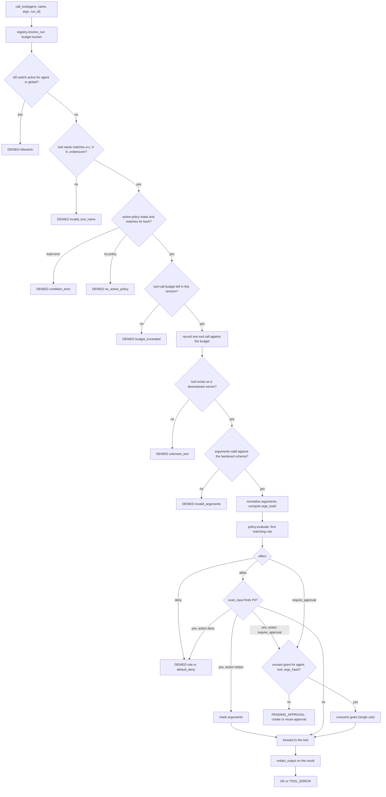
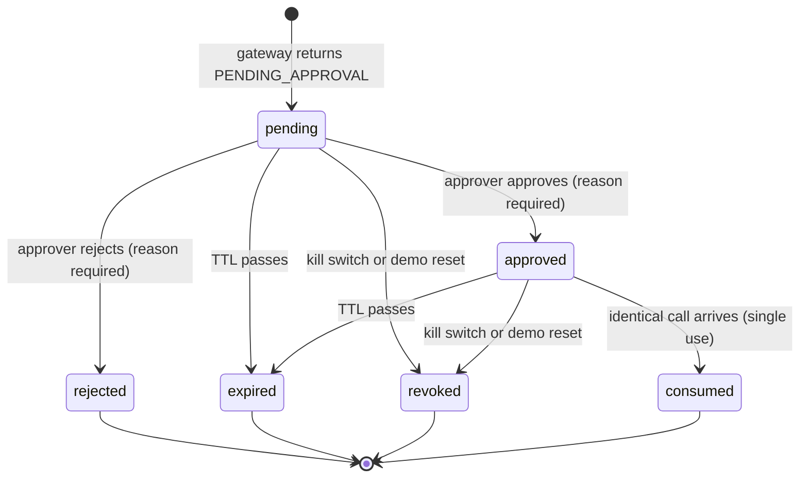

**Bastion Kit · design/LLD.md**

# Bastion: low-level design

> Reference implementation; not production; not legal advice. All data is synthetic.

This document describes the code as it is, module by module: responsibility, public interface, data structures, algorithms, error cases and the tests that cover it. Paths are relative to the repository root. Where the code differs from the original specification, see [`DIVERGENCES.md`](DIVERGENCES.md). For the big picture see [`HLD.md`](HLD.md).

## 1. Module map

| Package | Files | Responsibility |
|---|---|---|
| `src/bastion/gateway/` | `mcp_proxy.py`, `server.py`, `policy_engine.py`, `conditions.py`, `normalize.py`, `redaction.py`, `budgets.py` | The enforcement point: decide every tool call, forward allowed ones, mask PII |
| `src/bastion/oversight/` | `approvals.py`, `killswitch.py` | Human approvals as single-use grants; kill switch |
| `src/bastion/incidents/` | `service.py` | Incident rules and lifecycle |
| `src/bastion/audit/` | `log.py`, `verify.py` | Hash-chained event log and its verification |
| `src/bastion/registry/` | `service.py`, `models.py`, `assessor_graph.py`, `classification.py` | Agents, tokens, runs, policy versions; classification and sign-off |
| `src/bastion/llm/` | `client.py`, `fixtures.py`, `governance.py` | Governed model client with replay, record and live modes |
| `src/bastion/evidence/` | `generator.py`, `pdf.py`, `cli.py`, `templates/pack.html.j2` | Evidence pack |
| `src/bastion/api/` | `main.py`, `state.py`, `auth.py`, `runs.py`, `schemas.py`, `routers/*.py` | Control-plane API; hosts the gateway at `/mcp` |
| `src/bastion/console/` | `app.py`, `client.py`, `common.py`, `format.py`, `views/*.py`, `pages/*.py` | Streamlit console (an API client only) |
| `src/bastion/` | `config.py`, `db.py`, `models.py`, `seed.py`, `headers.py`, `cli.py` | Settings, SQLite engine and scopes, tables, seeding, shared header names, CLI |
| `demo/` | `loan_ops_agent/`, `tools_server/`, `data/` | The governed demo agent, the bank's tool server, synthetic data |
| `evals/` | `run.py`, `scenario.py`, `assessor_suite.py`, `redteam/`, `benign/`, `assessor/` | Eval suites and the gate |

## 2. Gateway

### 2.1 `Gateway.call_tool` (`gateway/mcp_proxy.py`)

**Interface.** `await Gateway.call_tool(agent_id, name, arguments, run_id=None) -> GatewayResult`. `GatewayResult` carries `status` (`OK`, `DENIED`, `PENDING_APPROVAL`, `TOOL_ERROR`), the `Decision`, the `payload` the agent receives, `args_hash`, redaction counts, `overhead_ms` (gateway time excluding the tool) and `downstream_ms`. `await Gateway.list_tools(agent_id)` returns only the tools whose policy can allow them.

**Order of evaluation.** `call_tool` resolves the budget bucket, calls `_decide_and_forward`, computes the overhead, writes the audit event, and runs incident rules after a denial. `_decide_and_forward` stops at the first step that decides:



Points that are easy to miss:

- The budget is charged before the catalogue lookup and argument validation, so malformed and unknown-tool calls count against the session. A denied call for kill switch, invalid name, missing policy or an exhausted budget is not charged.
- A kill-switch denial does not run incident rules (`call_tool` checks the reason prefix), so a killed agent cannot pile up incidents.
- For malformed arguments the gateway asks `policy.unconditional_deny(tool)`: if the tool is denied whatever its arguments (R-007), the denial is reported under that rule and category, so an injected export with sloppy arguments still counts as exfiltration.
- `_pending` masks the arguments with all supported entity types before storing them on the approval, and writes `approval_requested` only when a new approval row was created.
- `_audit_decision` records masked arguments when they validated, and only the field names when they did not.

**Downstream connections.** `DownstreamPool` keeps one `_Connection` per distinct `downstream.command`. Each connection is owned by one background task that enters the MCP stdio client, lists tools, and waits; request tasks only call into `connection.client`. The subprocess gets a minimal environment (`_PASS_THROUGH_ENV` plus `BASTION_DEMO_DB`), never the API key or the passcode. `python` in a command means the current interpreter.

**Errors.** A downstream tool error comes back as `TOOL_ERROR` with the message masked. A missing connection is a `TOOL_ERROR`, never an allow.

**Tests.** `tests/test_gateway.py` (31 tests: allow with masking, default deny, name and argument attacks, approvals, DLP, discovery, budget, policy integrity, tool errors), `tests/test_gateway_http.py` (the same gateway over MCP streamable HTTP with bearer tokens), `tests/test_gateway_latency.py` (overhead p95 under 50 ms over 100 calls).

### 2.2 MCP front door (`gateway/server.py`)

`build_mcp_server` creates a low-level `mcp.server.lowlevel.Server` with `on_list_tools` and `on_call_tool`. `BearerAuth` is ASGI middleware in front of it: it reads `Authorization: Bearer <token>`, resolves it with `Registry.authenticate`, answers `401` and writes an `auth_failed` audit event otherwise, and puts the agent id and the `x-bastion-run` header into the ASGI scope. `build_mcp_route` returns a single Starlette route for the API to mount plus the session manager whose `run()` the API holds open; `build_mcp_app` is the standalone app used by `make demo` and the evals. Transport is streamable HTTP, stateless, JSON responses.

### 2.3 Policy engine (`gateway/policy_engine.py`)

**Data structures (Pydantic, `extra="forbid"`).** `Policy{agent, version_note, downstream[], budgets, incident_rules[], rules[]}`; `Rule{id, tool, effect, when?, redact_output[], scan_input?, category?}`; `IncidentRule{id, when, severity, on_incident?}`; `Budgets{max_tool_calls_per_session?, max_tokens_per_session?, max_cost_usd_per_day?}`; `Decision{effect, rule_id?, policy_hash, reasons[], redactions[], scan_input?, category?}`.

**Loading.** `Policy.from_yaml` parses with `yaml.safe_load`, validates, compiles every `when` with `compile_condition` (a bad condition fails the load), rejects duplicate ids, and stores `content_hash(text)`: the sha256 of the exact YAML text. Any failure raises `PolicyLoadError`; nothing is stored.

**Evaluation (`Policy.evaluate`).** Rules are visited in file order. A rule is skipped unless `rule.tool == tool` exactly. If it has a condition, the condition is evaluated against `{"agent": ..., "args": ...}`; `False` skips the rule; a `ConditionError` returns `deny` with reason `condition_error` (fail closed). The first rule that applies decides. No rule: `deny` with reason `default_deny`. `redact_output` and `scan_input` are carried on the decision only when the effect is `allow`.

**Discovery.** `visible_tools()` is the set of tools with at least one `allow` or `require_approval` rule.

**Tests.** `tests/test_policy_engine.py` (11 tests), plus the policy-integrity tests in `tests/test_gateway.py`.

### 2.4 Condition evaluator (`gateway/conditions.py`)

No `eval`, no `exec` (ruff rules S102 and S307 enforce it repository-wide).

**Compile (`compile_condition`)**: reject empty input and input over 500 characters; `ast.parse(mode="eval")`; reject trees over 100 nodes; then `_validate` walks the tree and rejects everything outside this whitelist:

| Allowed | Detail |
|---|---|
| Literals | `None`, strings, ints, floats, bools; lists and tuples of allowed nodes |
| Names | only `args`, `agent`, `tier`, `deny_count_10m`, `category` |
| Attribute access | only `args.<field>`, and not a field starting with `_` |
| Boolean logic | `and`, `or`, `not` |
| Arithmetic | `+ - * / %`, unary minus |
| Comparisons | `== != < <= > >=`, `in`, `not in` |
| Calls | `len`, `lower`, `startswith`, `endswith`, `contains`, `pct_change`, `now_hour`: positional arguments only, exact arity |

Everything else (subscripts, lambdas, comprehensions, other names or calls such as `__import__`) raises `ConditionError` at load.

**Evaluate (`Condition.evaluate`)** walks the validated tree. It is strict about types so that a policy cannot silently mean something else:

- `and` / `or` / `not` need real booleans; `and` / `or` short-circuit.
- Arithmetic needs numbers, and a bool is not a number.
- Equality holds when both sides have the same type and are equal, or both are numbers and equal; so `True == 1` is false.
- Ordering needs two numbers or two strings.
- `in` delegates to `contains` (string in string, item in list).
- A missing `args` field or a name absent from the context raises `ConditionError`.
- The final result must be a bool.
- `TypeError`, `ValueError` and `ArithmeticError` (for example division by zero) are converted to `ConditionError`.

`pct_change(old, new)` returns `(new - old) / abs(old) * 100`; from zero it is `0.0` if `new` is zero and infinity otherwise.

**Tests.** `tests/test_conditions.py` (10 tests, parametrised over allowed and rejected constructs).

### 2.5 Argument hardening and hashing (`gateway/normalize.py`)

- `is_valid_tool_name`: full match of `[a-z][a-z0-9_]{0,63}`. No trimming, no case folding.
- `harden_schema`: deep-copies the tool's JSON schema and sets `additionalProperties: false` on every object node, whether or not the tool declared it.
- `validate_and_normalise(arguments, schema)`: `None` becomes `{}`; a non-object is rejected; validation uses `jsonschema.Draft202012Validator`; the first error (ordered by path) is reported as `<path>: unknown field` or `<path>: fails '<keyword>' check`. The offending value is never included. Then `_normalise`:

| Input | Result |
|---|---|
| `bool`, `None`, `int` | unchanged |
| `float` | rejected if NaN or infinite; integral floats become `int` (`60000.0` and `6e4` are `60000`) |
| `str` | rejected if it contains control characters; NFC-normalised |
| `list`, `dict` | normalised recursively; dict keys must be strings |
| anything else | rejected |

- `args_hash(arguments)` = `sha256(canonical_json(arguments))`, where `canonical_json` (`llm/fixtures.py`) is `json.dumps(sort_keys=True, separators=(",", ":"), ensure_ascii=False)`. Because normalisation runs first, the same logical call always hashes the same, and any change to any argument changes the hash.

A numeric string such as `"60000"`, or digits in another script, fails the schema's `number` type and never reaches a policy condition.

**Tests.** `tests/test_normalize.py` (8 tests); the RT-08 to RT-12 cases in `tests/test_gateway.py`.

### 2.6 PII engines (`gateway/redaction.py`)

`BaseRedactor` holds the shared logic: `redact_text` replaces each span, last first, with `<ENTITY_TYPE>` and counts per type; `redact` walks any JSON-like value; `scan` returns only the counts. `resolve_overlaps` sorts candidate spans by score (highest first) then start, and keeps a span only if it does not overlap one already kept.

- `Redactor` (default): Presidio `AnalyzerEngine` on spaCy `en_core_web_sm` with the parser and NER stages disabled, plus an extra e-mail pattern for reserved test domains. Minimum score 0.35. Imports are inside `__init__`.
- `LightRedactor` (`BASTION_LOW_MEMORY=true`): an e-mail pattern; IBAN candidates shortened from the right until the compact form has the country's length (table `IBAN_LENGTHS`), ends at a word boundary and passes mod 97; card-like digit groups kept only if Luhn holds; phone numbers from `phonenumbers.PhoneNumberMatcher` for eight regions.

Supported entity types: `EMAIL_ADDRESS`, `PHONE_NUMBER`, `IBAN_CODE`, `CREDIT_CARD`. `get_redactor(low_memory)` caches one engine per profile.

**Tests.** `tests/test_demo_data_and_redaction.py`, `tests/test_low_memory.py` (the two engines return identical spans on the demo data, eval inputs and a list of edge cases).

### 2.7 Budgets (`gateway/budgets.py`, `llm/governance.py`)

Accounting lives in the `usage` table, one row per counted event.

| Budget | Where enforced | Check | Recorded |
|---|---|---|---|
| `max_tool_calls_per_session` | `BudgetTracker.check_tool_call` in the gateway | count of `usage` rows with `kind='tool'` for (agent, run) `>=` cap denies | `record_tool_call` adds a row before the call is evaluated further |
| `max_tokens_per_session` | `GovernanceHook.before_call` | sum of `tokens_in + tokens_out` for (agent, run, `kind='model'`) `>=` cap raises `BudgetExceeded` | `after_call` adds a row with tokens and cost |
| `max_cost_usd_per_day` | `GovernanceHook.before_call` | sum of `cost_usd` for the agent since UTC midnight `>=` cap raises `BudgetExceeded` | same row |

A "session" is a run id that Bastion itself issued for that agent (`Registry.resolve_run`). Any other run id, or none, maps to the shared bucket `unbound`, so inventing run ids cannot reset a budget. Both the gateway (tool calls) and `GovernanceHook` (model tokens) resolve the session this way; the daily cost cap is per agent. `before_call` also checks the kill switch first and raises `KillSwitchActive`. Every blocked model call writes a `model_call_blocked` audit event.

**Tests.** `test_rt20_call_31_in_a_session_is_denied`, `test_invented_run_ids_share_one_budget_bucket` (`tests/test_gateway.py`); the RT-21 tests and `test_invented_run_ids_do_not_reset_the_model_token_budget` in `tests/test_oversight.py`.

## 3. Oversight

### 3.1 Approvals and grants (`oversight/approvals.py`)

An approval row is keyed by `(agent_id, tool, args_hash)` and carries the masked arguments, the rule id, `expires_at` (TTL 30 minutes by default) and a status. A grant is simply an approval in status `approved`.



- `request(...)` reuses an unexpired `pending` approval for the same key; otherwise it creates one. The id is `APR-` plus the first ten hex characters of `sha256(agent|tool|args_hash|ordinal)`, where the ordinal is the number of earlier approvals for the same key. Deterministic ids keep replayed model fixtures stable.
- `decide(...)` requires a non-blank reason, expires stale rows, then issues one `UPDATE ... WHERE id = ? AND status = 'pending'`. If no row changed, it raises `ApprovalError`. A concurrent revocation therefore cannot be overwritten.
- `consume_grant(agent, tool, args_hash)` expires stale rows, selects the `approved` row for that exact key and claims it with `UPDATE ... WHERE id = ? AND status = 'approved'`. Only one caller can win; the event `grant_consumed` is written.
- `revoke_open(agent | None, ...)` sets `pending` and `approved` rows to `revoked` and audits each.
- `expire_stale()` flips `pending` and `approved` rows past `expires_at` to `expired`.

Why approve-then-swap fails: the swapped call normalises to different arguments, so its hash differs, `consume_grant` finds nothing, and a new `pending` approval is created. The original grant stays `approved` and unused until it expires.

**Tests.** `tests/test_oversight.py` (16 tests: RT-13 to RT-16 and the lifecycle), `test_uc04_*` and `test_uc05_*` in `tests/test_demo_scenarios.py` and `tests/test_api.py`.

### 3.2 Kill switch (`oversight/killswitch.py`)

One row per scope in `killswitch`: the scope is an agent id or `global`. `global` and `unbound` are reserved and cannot be agent ids.

- `active_scope(agent)` returns `global`, the agent id or `None`; the gateway and the model hook call it first.
- `kill(scope, reason, actor)`: in one unit of work it marks the switch active, sets affected `active` agents to `killed`, and sets their `running` and `interrupted` runs to `halted`. Then it revokes open approvals, writes `killswitch_activated` with the revoked approvals and halted runs, and opens a `KILLSWITCH` incident for each affected agent that has no open incident.
- `reactivate(scope, reason, actor)` needs a reason, clears the switch and returns `killed` agents to `active` unless the global switch still holds them.

A killed agent still authenticates, so its calls are denied and recorded rather than disappearing as `401`.

**Tests.** `tests/test_oversight.py`, `test_kill_revokes_pending_and_halts_the_parked_run` and `test_global_kill_and_reactivate` in `tests/test_api.py`, RT-22.

### 3.3 Incidents (`incidents/service.py`)

- `evaluate_rules(agent, policy, category, trigger)` runs after a denial. The context is `{"deny_count_10m": ..., "category": ...}`. Each policy `incident_rule` whose condition holds opens an incident for (agent, rule) unless one is already open; the caller receives newly opened incidents with their `on_incident` action, and the gateway trips the kill switch for `kill`.
- `deny_count_10m` counts `tool_decision` audit events of the last ten minutes with status `DENIED`, excluding kill-switch denials.
- `advance(id, status, actor, note)` moves strictly forward through `open → acknowledged → contained → resolved`, requires a note, appends it to `notes_json` and audits the step.

**Tests.** `tests/test_oversight.py`, `test_rt01_exfiltration_deny_opens_a_high_incident_and_kills_the_agent` (`tests/test_gateway.py`), `test_uc03_*`.

## 4. Audit

### 4.1 Append (`audit/log.py`)

Each event is `{seq, ts, actor, event_type, agent_id, payload}`.

```
payload_json = canonical_json(payload)
BEGIN IMMEDIATE                                  -- take the SQLite write lock first
  (head_seq, head_hash) = newest row, or (0, "0" * 64) if the log is empty
  seq       = head_seq + 1
  prev_hash = head_hash
  ts        = now (UTC, ISO-8601, microseconds)
  hash      = sha256(prev_hash + canonical_json({seq, ts, actor, event_type, agent_id, payload}))
  INSERT (seq, ts, actor, event_type, agent_id, payload_json, prev_hash, hash)
COMMIT
```

Taking the write lock before reading the head means two writers can never extend the same head.

### 4.2 Verify (`audit/verify.py`)

`verify_chain(engine) -> VerifyResult{ok, events, first_broken_seq?, reason?, head_hash}` reads all rows in `seq` order and checks, for each row in turn: (1) `seq` is the next integer (a gap means deletion or reordering); (2) `prev_hash` equals the previous row's `hash`; (3) the recomputed hash equals the stored `hash`. It stops at the first failure.

Detected: modification of any field, deletion from the middle, reordering. Not detected: removal of the newest events, because nothing outside the database records the head.

**Tests.** `tests/test_audit.py` (9 tests, including an eight-thread concurrency test), RT-24, `test_tampering_shows_up_in_verify_and_overview` (`tests/test_api.py`).

## 5. Registry and classification

### 5.1 `Registry` and `PolicyStore` (`registry/service.py`)

- Agents: `create_agent` (rejects reserved and duplicate ids), `get_agent`, `list_agents`.
- Tokens: `issue_token` requires status `active`, generates `secrets.token_urlsafe(32)`, stores only its sha256, returns the token once. `authenticate` looks the hash up and accepts agents in status `active` or `killed`.
- Runs: `start_run` (id `run-` + 12 hex), `set_run_status`, `set_run_text`, `resolve_run`.
- Policies: `PolicyStore.activate(agent, yaml, created_by)` validates, checks the policy names this agent, deactivates the previous version, inserts version `max + 1` as active and audits `policy_activated` with the new and previous hash. `active(agent)` re-checks that the stored text still matches its stored hash (a mismatch raises `PolicyLoadError`, so the gateway denies everything) and caches parsed policies by hash.

### 5.2 Classification (`registry/assessor_graph.py`, `registry/classification.py`)

`classify(deps, card)` runs the graph `retrieve → assess → review → (revise) → END`; see [`AGENT_ARCHITECTURE.md`](AGENT_ARCHITECTURE.md). `_structured` calls the model with `output_config.format` (JSON schema), raises `AssessmentError` unless `stop_reason == "end_turn"`, and validates the text with Pydantic.

`ClassificationService`:

| Method | Status change | Notes |
|---|---|---|
| `submit_card` | none → `draft` | stores card version 1, audits `agent_card_submitted` |
| `run_assessment` | `draft` → `assessing` → `awaiting_signoff` | on failure the previous status is restored; stores assessor, reviewer and revised JSON; audits `assessment_completed` |
| `sign_off(tier, approver, override_reason)` | `awaiting_signoff` → `active` or `blocked` | a tier other than the proposed one needs a reason; claimed by one conditional `UPDATE`; `prohibited` → `blocked`, no policy, no token; otherwise `policy_for` picks `policies/<agent-id>.yaml` if it exists, else `policies/templates/<tier>.yaml`, activates it and issues the token |

**Tests.** `tests/test_classification.py` (17 tests), the registry tests in `tests/test_api.py` and `tests/test_console.py`, `evals/assessor_suite.py`.

## 6. Governed model client (`llm/`)

`GovernedAnthropic.create(model, messages, max_tokens, run_id, **params)`:

1. Build the request dict and `fixture_key = sha256(canonical_json(request without None values))`.
2. Call every hook's `before_call` (kill switch and budgets; may raise).
3. `replay`: load `fixtures/llm/<key>.json` or raise `ReplayMissError`. `record` and `live`: call the transport; `record` also saves the fixture.
4. Compute usage and cost from `config/prices.yaml` (`UnknownModelPriceError` if the model has no price).
5. Call every hook's `after_call` (usage row and `model_call` audit event).

No `temperature` is sent. The Anthropic SDK is imported only when a live transport is first used.

**Tests.** `tests/test_llm_client.py` (11 tests).

## 7. Evidence (`evidence/`)

`collect(engine, agent_id)` reads the agent, its registration record, the active policy, the agent's audit events, approvals, incidents and usage, the latest eval results, and runs `verify_chain`. It builds an `EvidencePack`. The framework mapping lists only capabilities for which evidence is present; the red-team row appears only when the eval results were produced against the policy in force (`policy_hash` match). `render_html` uses Jinja2 with autoescape. `html_to_pdf` prints with headless Chromium, the document name in the header and `Page X of Y` in the footer. `generate` also writes an `evidence_generated` audit event.

**Tests.** `tests/test_evidence.py` (13 tests).

## 8. API and run manager (`api/`)

- `create_app(settings)` builds the state in the lifespan, appends the gateway route and holds the MCP session manager open. Endpoints: see [`API.md`](API.md).
- `auth.require_passcode`: `403` if no passcode is configured; otherwise a constant-time comparison (`hmac.compare_digest`) and `401` on mismatch, with a throttled `passcode_rejected` audit event.
- `RunManager.start(scenario, approver, actor)`: refuses while a run task is alive or the global kill switch is active (`409`), refuses `approver=human` without a configured passcode (`403`), marks abandoned runs `halted`, resets the demo state, opens the run and spawns an asyncio task. `on_decision(approval)` resumes a parked run when its last pending approval has been decided. A `ReplayMissError` ends the run as `completed` with an explanatory text; any other exception marks it `failed` and exposes only the exception type.

**Tests.** `tests/test_api.py` (32 tests), `tests/test_console.py` (15 tests).

## 9. SQLite transactions and locking (`db.py`)

- One engine per database file; WAL journal, `synchronous=NORMAL`, foreign keys on, a 15 s busy timeout, and the driver's implicit `BEGIN` disabled so transactions are explicit.
- `session_scope(engine)`: a unit of work that begins with `BEGIN IMMEDIATE`. Read-then-write units of work would otherwise start deferred and fail with `database is locked` when another connection commits before the upgrade; SQLite's busy timeout does not cover that case. With the lock taken up front, writers queue.
- `read_scope(engine)`: a deferred, read-only scope for hot-path lookups (kill-switch check, token lookup, run and policy lookup, budget count). It never takes the write lock.
- `AuditLog.append` opens its own connection with the `immediate` option for the same reason as above.
- There is one writer at a time by design. That is acceptable for a single-node reference implementation and is the first thing to change for scale.

**Tests.** `test_concurrent_read_then_write_units_of_work_do_not_fail_with_database_is_locked` (`tests/test_audit.py`).

## 10. Error handling summary

| Situation | Behaviour | Where |
|---|---|---|
| No rule matches | deny, `default_deny` | `Policy.evaluate` |
| Condition raises at evaluation | deny, `condition_error` | `Policy.evaluate` |
| Policy fails to load, or stored text does not match its hash | deny, `condition_error` | `Gateway._decide_and_forward`, `PolicyStore.active` |
| No active policy | deny, `no_active_policy` | `Gateway._decide_and_forward` |
| Unknown or malformed tool name | deny | `Gateway._decide_and_forward` |
| Invalid arguments | deny, `invalid_arguments`, value not logged | `validate_and_normalise` |
| Tool raises | `TOOL_ERROR`, message masked | `Gateway._forward` |
| Model output not valid, refusal or truncation | `AssessmentError`; the agent stays a draft | `assessor_graph._structured` |
| Replay fixture missing | `ReplayMissError`; scenario ends with an explanation; registration answers `409` | `llm/client.py`, `api/runs.py`, `api/routers/registry.py` |
| Missing or wrong passcode | `403` or `401` | `api/auth.py` |
| Missing or invalid agent token | `401`, audited | `gateway/server.py` |
| Chromium not installed, or low-memory profile | PDF route answers `503`; HTML still works | `api/routers/evidence.py` |

---
*design/LLD.md · Page 1 of 1*
